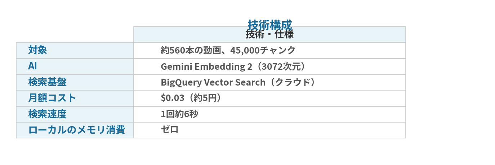

YouTubeのコメント欄で、視聴者からこんなリクエストが来た。

「あるメンバーが冗談で別のメンバーに無茶振りをして、振られた側が『そんなの余裕だよ』って返してたシーン、どの動画か分かりませんか？」

ざっくりした記憶だけで、どの動画かも分からない。元チャンネルは10,000本以上の動画がある。

人間が1本ずつ確認していたら、何日かかるか分からない。

AIにやらせたら、10分で見つかった。

---

## まず1年分の字幕を検索可能にした

前提として、自分は元チャンネルの1年分の動画（800本以上）の字幕データを全てインデックス化してある。

仕組みはこうだ。

1. 全動画の字幕を30秒チャンクに分割
2. 各チャンクをGemini Embedding 2でベクトル化
3. BigQuery Vector Searchに格納（約45,000チャンク）
4. 検索時はクエリもベクトル化して、意味的に近いチャンクを返す

キーワード一致ではなく「意味」で検索するから、多少表現が違っても関連するシーンがヒットする。

---

## 最初の検索：意味は近いが違う

視聴者のリクエストからキーワードを抽出し、セマンティック検索をかけた。

10件ヒットしたが、どれも探しているシーンではなかった。似たような文脈の発言は出てくるが、ピンポイントで「あの一言」にはたどり着けない。

クエリを変えて再検索。より具体的な文脈を含めた検索文にした。意味的に近い結果が増えたが、まだ確信が持てない。

---

## 作戦変更：キーワード直接検索

セマンティック検索は「意味が近い」結果を返すが、特定のセリフを探すには広すぎる。

作戦を変えた。全字幕データから、視聴者が覚えていた特徴的な単語を直接検索（grep）。

1年分800本の字幕から、その単語を含む動画が9本に絞れた。各動画のタイムスタンプを確認していく。

---

## 発見：2時間6分の場所

ある動画の2時間6分付近で、まさにそのやり取りが見つかった。

メンバーAがルール変更の責任として「メンバーBが後日やります」と勝手に宣言。メンバーBは「それは余裕だよ」と即答。周りのメンバーも「余裕なんだ…」とざわつく。

タイムスタンプ付きURLを生成して、視聴者に返信できる状態になった。

---

## セマンティック検索 vs キーワード検索

今回の教訓。

**セマンティック検索が万能ではない。**

「意味が近い」結果を返すのは得意だが、「この一言を探す」という用途ではキーワード検索の方が確実。今回も最終的にはgrepで見つけた。

逆に、「おもしろいシーンを探して」のような曖昧な検索にはセマンティック検索が圧倒的に強い。

**ベストは両方使うこと。** 自分のシステムでは、セマンティック検索（BigQuery Vector Search）とキーワード検索（grep）を併用している。

---

## 技術構成

以前はローカルのFAISSインデックス（3.4GB）で動かしていたが、メモリを食うのでBigQueryに移行した。ローカルにファイルを持たなくていいし、月$0.03で済む。

---

## まとめ

- 822本の字幕データから特定のセリフを10分で発見
- セマンティック検索で候補を絞り、キーワード検索でピンポイント特定
- 視聴者のリクエストにAIで応えられる時代
- 字幕検索システムの構築コストは月$0.03

視聴者と一緒にコンテンツを楽しめる仕組みがあると、チャンネル運営が一段と面白くなる。
